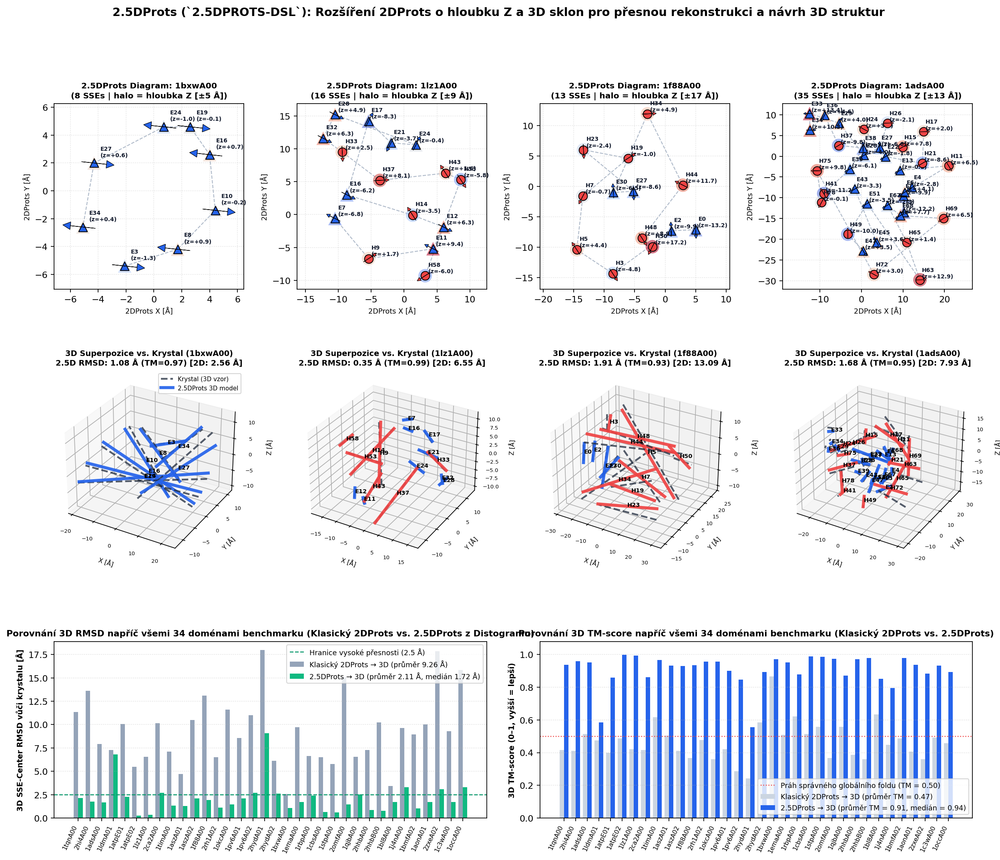
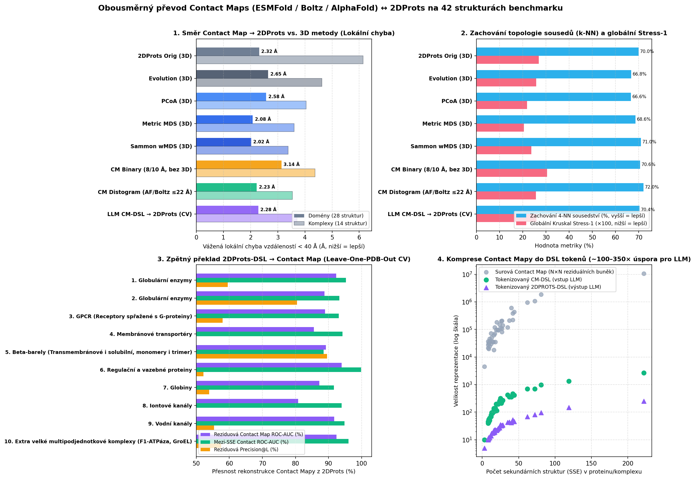

# 2.5DProt (`2.5DProts`) — Bidirectional Contact Map / Distogram ↔ 2DProts / 2.5DProts ↔ 3D Protein Generation

**2.5DProt** extends classic [2DProts](https://2dprots.ncbr.muni.cz) protein secondary-structure topology diagrams ([upstream GitLab](https://gitlab.com/jhutar/2dprot)) with:
1. **Direct Contact Map / Distogram → 2DProts projection** (without 3D coordinates, using residue-level shortest-path geodesics and ridge covariance angles).
2. **Compact Domain-Specific Token Languages (`CM-DSL`, `2DPROTS-DSL`, `2.5DPROTS-DSL`)** and a fast bidirectional translator ([`utils_contactmap_llm.py`](utils_contactmap_llm.py)).
3. **2.5D Depth & 3D Orientation Layer (`2.5DPROTS-DSL`)** enabling sub-2 Å median 3D SSE-center reconstruction from distograms ($\le 22\text{ Å}$, zero 3D crystal coordinates) and direct *de novo* 3D backbone generation (`.cif` / `.pdb`).

For the full Czech technical report with equations, token examples, and detailed domain breakdowns, see [`docs/2.5DProts_Report_CZ.md`](docs/2.5DProts_Report_CZ.md).

---

## 1. Overview & Motivation

Classic **2DProts** diagrams project 3D secondary-structure elements (SSEs) onto a 2D plane $(x_i, y_i, \alpha_i)$. While effective for neighborhood visualization and homology comparison, pure 2D coordinates collapse the out-of-plane depth axis $Z_i$ ($\sigma_3 \approx 5.5\text{–}14.6\text{ Å}$ in globular and transmembrane folds) and encode minimal segment distances $D_{\min}$ rather than SSE centers, making direct `2DProts → 3D` inversion underdetermined (mean 3D SSE-center RMSD **$9.26\text{ Å}$**, TM-score **$0.466$**).

**2.5DProts (`2.5DPROTS-DSL`)** augments each SSE token with out-of-plane depth `Z`, 3D elevation tilt `EL`, 3D center `C`, spherical direction `U`, and physical SSE span `S` reconstructed purely from residue-level distograms ($\le 22\text{ Å}$, e.g. AlphaFold / ESMFold / Boltz style) via 2M-endpoint 3D MDS + weighted SMACOF stress majorization:



---

## 2. `2.5DPROTS-DSL` Token Specification

Each SSE is represented by a backward-compatible token combining standard 2DProts geometry (`X, Y, A`) with 2.5D/3D descriptors (`Z, EL, C, U, S`):

```text
<BOS_25DP>
CLUST:E1:E2:E3:E4:E5:E6:E7:E8:E9:E10
SSE25D:E1:L11:X+008.4:Y+000.0:Z+000.0:A090:EL+68
...
SSE25D:H1:L17:X+000.0:Y+000.0:Z+000.0:A000:EL+88
<EOS_25DP>
```

Full reconstructed format (e.g., human lysozyme `1lz1A00`, helix `H14`):

```text
SSE25D:H14:L17:X+001.3:Y-000.1:Z-003.5:A327:EL-41:C+001.7,-001.9,-003.5:U324,-41:S17.7
```

* `L{len}` — residue length of the SSE
* `X{x}:Y{y}:A{ang}` — classic 2DProts planar position (Å) and 2D orientation angle (°)
* `Z{z}:EL{el}` — 2.5D out-of-plane depth $Z$ (Å) and 3D elevation tilt (`-90°` to `+90°`)
* `C{cx},{cy},{cz}:U{az},{el}:S{span}` — 3D SSE center, spherical axis orientation, and endpoint-to-endpoint span (Å)
* `CLUST:E1:E2:...` — $\beta$-sheet connectivity clusters

Compact human-authored `2.5DPROTS-DSL` strings specifying only `X, Y, Z, A, EL` (and `CLUST`) can be compiled directly into 3D `.cif` / `.pdb` models via [`reconstruct_3d_structure_from_25dprots_dsl`](utils_contactmap_llm.py) (see *de novo* examples in [`benchmark_dimred_results/models_3d/`](benchmark_dimred_results/models_3d)):
* `denovo_25d_gfp_barrel_10B1H.cif` — 10-stranded antiparallel $\beta$-barrel with coaxial central $\alpha$-helix `H1`
* `denovo_25d_rossmann_3layer_4E4H.cif` — 3-layer $\alpha/\beta/\alpha$ Rossmann-like sandwich ($Z = -7.6 / 0.0 / +7.6\text{ Å}$)
* `modified_25d_1bxw_helix_plug.cif` — engineered OmpA $\beta$-barrel (`1bxwA00`) with an inserted coaxial helical pore plug `H99`

---

## 3. Key Benchmark Results

### A. 3D Reconstruction Across 34 CATH/PDB Benchmark Domains (`Distogram ≤ 22 Å → 2.5DPROTS-DSL → 3D`)

Evaluated with zero 3D crystal coordinates during reconstruction ([`generate_3d_from_2dprots.py`](generate_3d_from_2dprots.py), summary in [`benchmark_dimred_results/models_3d_summary.json`](benchmark_dimred_results/models_3d_summary.json)):

| Domain / Aggregate | SSEs | Classic `2DProts → 3D` Center RMSD | Classic `2DProts → 3D` TM-score | **`2.5DProts → 3D` Center RMSD** | **`2.5DProts → 3D` Endpoint RMSD** | **`2.5DProts → 3D` TM-score** | `2.5DProts` Time |
| :--- | :---: | :---: | :---: | :---: | :---: | :---: | :---: |
| **`1lz1A00`** (Human lysozyme, $\alpha+\beta$) | 16 | $6.55\text{ Å}$ | $0.422$ | **$0.35\text{ Å}$** | **$0.44\text{ Å}$** | **$0.993$** | $18.2\text{ ms}$ |
| **`1bxwA00`** (OmpA 8-strand $\beta$-barrel) | 8 | $2.56\text{ Å}$ | $0.866$ | **$1.08\text{ Å}$** | **$1.67\text{ Å}$** | **$0.971$** | $10.3\text{ ms}$ |
| **`1adsA00`** (Aldose reductase TIM barrel) | 35 | $7.93\text{ Å}$ | $0.510$ | **$1.68\text{ Å}$** | **$1.83\text{ Å}$** | **$0.950$** | $61.3\text{ ms}$ |
| **`1f88A00`** (Rhodopsin 7TM GPCR) | 13 | $13.09\text{ Å}$ | $0.370$ | **$1.91\text{ Å}$** | **$3.08\text{ Å}$** | **$0.930$** | $23.8\text{ ms}$ |
| **Mean across 34 domains** | 16.9 | $9.26\text{ Å}$ | $0.466$ | **$2.11\text{ Å}$** | **$2.73\text{ Å}$** | **$0.907$** | **$35.2\text{ ms}$** |
| **Median across 34 domains** | 15.0 | $9.12\text{ Å}$ | $0.449$ | **$1.72\text{ Å}$** | **$2.36\text{ Å}$** | **$0.936$** | **$24.4\text{ ms}$** |

### B. Bidirectional `Contact Map ↔ 2DProts` DSL Translation Across 42 Structures (28 Domains + 14 Multi-Chain Complexes)

Evaluated in Leave-One-PDB-Out cross-validation ([`benchmark_contactmap_llm.py`](benchmark_contactmap_llm.py), summary in [`benchmark_dimred_results/contactmap_llm_summary.json`](benchmark_dimred_results/contactmap_llm_summary.json)):



* **Forward `CM-DSL → 2DPROTS-DSL` (`llm_cm2prot`):**
  * **$822.8\times$ compression** on average ($\sim 528\,898$ matrix cells → $307.3$ `CM-DSL` tokens → $36.5$ `2DPROTS-DSL` tokens).
  * Mean local distance error **$2.28\text{ Å}$ on domains** ($2.76\text{ Å}$ across all 42 structures), compared to `cm_distogram` (**$2.23\text{ Å}$** domains / $2.66\text{ Å}$ overall, $72.0\%$ 4-NN preservation) and classic 3D `Evolution` ($2.65\text{ Å}$ domains / $3.37\text{ Å}$ overall).
  * **$70.4\times$ faster on the 28 domains** ($47.7\text{ ms}$ vs. $3360.4\text{ ms}$) and **$40.8\times$ faster overall** ($219.7\text{ ms}$ vs. $8970.4\text{ ms}$) compared to classic `Evolution`.
* **Inverse `2DPROTS-DSL → Contact Map` (`llm_prot2cm`):**
  * **SSE-level Contact ROC-AUC:** **$93.6\%$** (**Precision@$L = 92.9\%$**, F1 = $75.8\%$).
  * **Inter-SSE Residue Contact ROC-AUC:** **$88.7\%$** (local distance MAE $\le 22\text{ Å}$: **$2.48\text{ Å}$**).

---

## 4. Repository Structure & Usage

### Installation

Python 3.10+ is recommended:

```bash
pip install -r requirements.txt
```

### Main Modules & Scripts

* [`utils_contactmap_llm.py`](utils_contactmap_llm.py) — Residue contact map / 64-bin distogram extraction, residue geodesic & ridge covariance reconstruction, `CM-DSL` / `2DPROTS-DSL` / `2.5DPROTS-DSL` compilers, `BidirectionalDSLTranslator`, 3D endpoint SMACOF reconstruction, atomic backbone builder, and mmCIF/PDB export.
* [`generate_3d_from_2dprots.py`](generate_3d_from_2dprots.py) — Benchmarks `2DProts → 3D` vs `2.5DProts → 3D` across all 34 domains and generates *de novo* / engineered `.cif` & `.pdb` models in [`benchmark_dimred_results/models_3d/`](benchmark_dimred_results/models_3d).
* [`benchmark_contactmap_llm.py`](benchmark_contactmap_llm.py) — Runs the 42-structure Leave-One-PDB-Out bidirectional `Contact Map ↔ 2DProts` DSL benchmark and builds the interactive HTML gallery [`benchmark_dimred_results/contactmap_llm.html`](benchmark_dimred_results/contactmap_llm.html).
* [`benchmark_dimred.py`](benchmark_dimred.py) & [`utils_dimred.py`](utils_dimred.py) — SSE-level dimensionality reduction benchmarks (Sammon, SMACOF, PCoA, Evolution, PCA, membrane/ligand extensions) and HTML gallery ([`benchmark_dimred_results/index.html`](benchmark_dimred_results/index.html)).
* [`benchmark_dimred_aa.py`](benchmark_dimred_aa.py) & [`utils_dimred_aa.py`](utils_dimred_aa.py) — Amino-acid level 2DProts dimensionality reduction benchmarks and HTML gallery ([`benchmark_dimred_aa_results/index.html`](benchmark_dimred_aa_results/index.html)).

### Running Benchmarks

```bash
# Reconstruct 3D structures via 2.5DProts across 34 benchmark domains + de novo designs
python generate_3d_from_2dprots.py

# Bidirectional Contact Map <-> 2DProts DSL benchmark (42 structures)
python benchmark_contactmap_llm.py

# SSE-level and AA-level dimensionality reduction benchmarks
python benchmark_dimred.py
python benchmark_dimred_aa.py
```

---

## 5. Upstream Attribution

This repository builds on top of the original **2DProts** secondary-structure topology diagram generator:
* Web service: <https://2dprots.ncbr.muni.cz>
* Upstream codebase: <https://gitlab.com/jhutar/2dprot>
