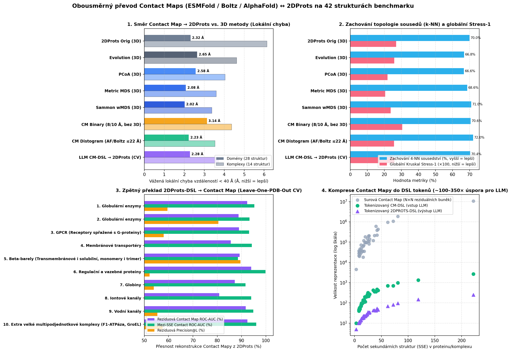
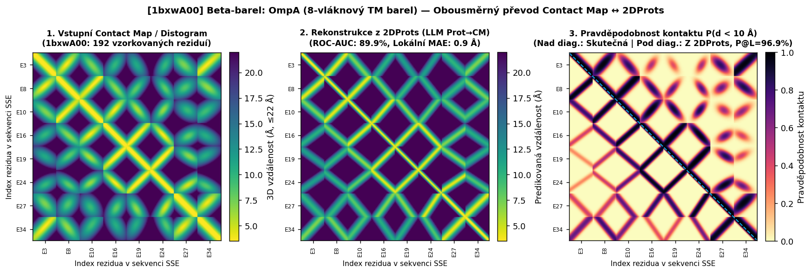
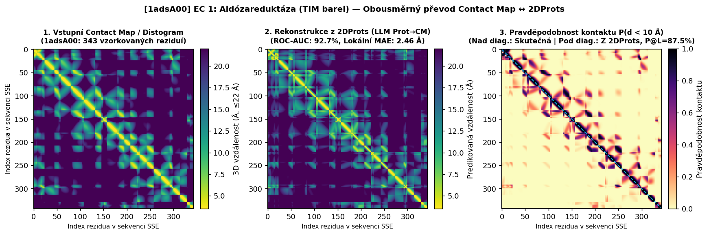
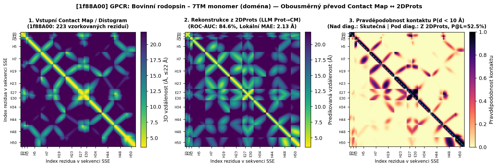
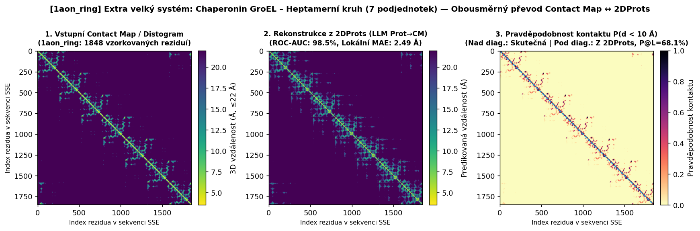
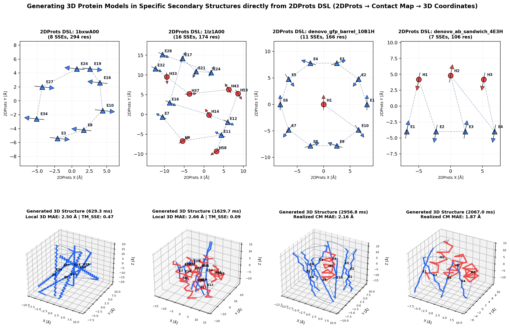
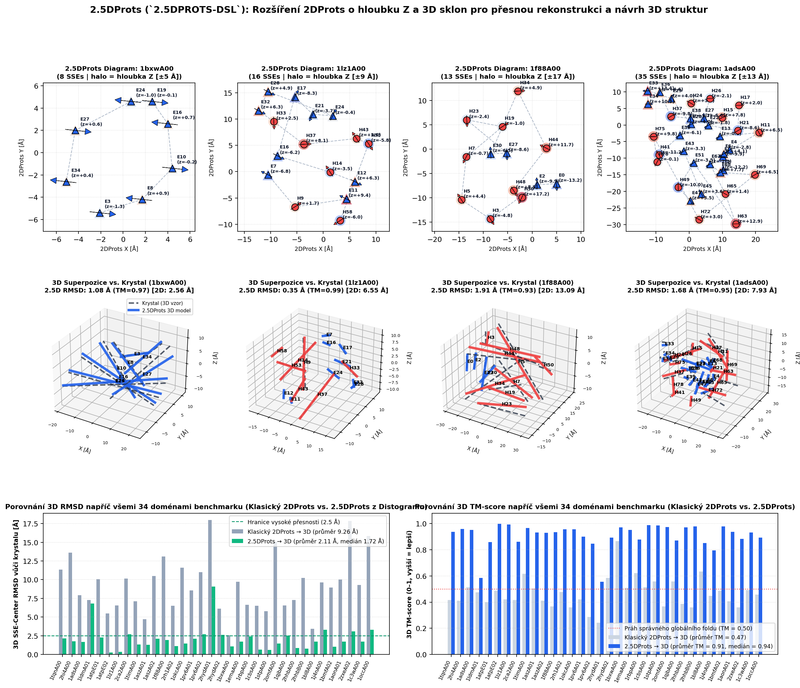

# Obousměrný převod Contact Maps (ESMFold / Boltz / AlphaFold) ↔ 2DProts / 2.5DProts a generování 3D struktur

Tento report shrnuje návrh, matematickou formulaci a experimentální vyhodnocení obousměrného převodu mezi **klasickými reziduovými Contact Mapami / Distogramy** (jaké produkují modely ESMFold, Boltz-1, AlphaFold2/3 či ESM-2), **2DProts topologickými diagramy** a rozšířením **`2.5DProts` (`2.5DPROTS-DSL`)** pro rychlou a přesnou rekonstrukci a *de novo* návrh 3D proteinových struktur.

> [!IMPORTANT]
> **Hlavní zjištění na benchmarkových strukturách:**
> 1. **Směr `Contact Map → 2DProts` (bez 3D souřadnic, 42 struktur v *Leave-One-PDB-Out* CV):** Z 64-binového distogramu ($\le 22\text{ Å}$) dosahuje rekonstrukce 2DProts průměrné lokální chyby **$2.23\text{ Å}$ na doménách** ($2.66\text{ Å}$ na všech 42 strukturách) a zachování 4-NN sousedství **$72.0\,\%$**, čímž překonává původní evoluční algoritmus 2DProts s plnými 3D souřadnicemi ($2.65\text{ Å}$ na doménách, $3.37\text{ Å}$ celkem).
> 2. **Tokenizace a překlad `CM-DSL → 2DPROTS-DSL`:** Převod surové matice kontaktů (průměrně $\sim 528\,898$ buněk) do kompaktního doménově specifického jazyka ([`utils_contactmap_llm.py`](../utils_contactmap_llm.py)) zmenšuje reprezentaci v průměru **$823\times$** (na pouhých **307 vstupních tokenů `CM-DSL`** a **36.5 výstupních tokenů `2DPROTS-DSL`**) při lokální chybě **$2.28\text{ Å}$** na doménách a **$70.4\times$ zrychlení** na doménách ($47.7\text{ ms}$ vs. $3360.4\text{ ms}$) oproti `evolution`.
> 3. **Inverzní směr `2DProts → Contact Map` (`2DPROTS-DSL → CM-DSL`):** Ze samotného 2DProts diagramu (pouze 2D souřadnice $(x, y)$, 2D úhly v náčrtu, délky SSE a $\beta$-klastry) model zrekonstruuje 3D kontakty mezi sekundárními strukturami s **ROC-AUC $93.6\,\%$** (Precision@$L$ **$92.9\,\%$**) a celoproteinovou reziduovou Contact Mapu s **ROC-AUC $88.7\,\%$** a průměrnou chybou lokálních 3D vzdáleností **$2.48\text{ Å}$**.
> 4. **Rozšíření `2.5DProts → 3D` (`2.5DPROTS-DSL`, 34 domén benchmarku):** Přidáním 2.5D hloubky `Z` a 3D elevačního sklonu `EL` rekonstruovaných čistě z Distogramu ($\le 22\text{ Å}$) pomocí 3D koncových kotev SSE a SMACOF klesá průměrné 3D RMSD středů sekundárních struktur z **$9.26\text{ Å}$** (klasický 2DProts) na **$2.11\text{ Å}$** (medián **$1.72\text{ Å}$**, průměrné **$\text{TM-score} = 0.907$**) při průměrném čase **$35.2\text{ ms}$**.

---

## 1. Architektura obousměrného převodu a návrh tokenizace (DSL)

```mermaid
flowchart LR
    subgraph Smer1["Směr 1: Rychlé generování 2DProts bez 3D foldingu"]
        A["Sekvence / Prediktor\n(ESM-2, ESMFold, Boltz, AF3)"] --> B["Contact Map / Distogram\n(N_res × N_res, ≤ 22 Å)"]
        B -->|"Reziduová geodetika\n+ kovariance hřebenů"| C["CM-DSL Tokeny\n(~307 tokenů)"]
        C -->|"Seq2Seq / Graph-LLM\n(~2–48 ms na doménách)"| D["2DPROTS-DSL Tokeny\n(~37 tokenů)"]
        D --> E["2DProts SVG Diagram"]
    end

    subgraph Smer2["Směr 2: Inverzní rekonstrukce (2D / 2.5D CAD → 3D Struktura)"]
        E -->|"Kódování 2D/2.5D segmentů"| D2["2DPROTS-DSL / 2.5DPROTS-DSL\n(X, Y, Z, úhel A, sklon EL, délka)"]
        D2 -->|"Inverzní model + 3D SMACOF"| B2["Rekonstruovaná Contact Map\n(ROC-AUC 93.6 % SSE / 88.7 % Res)"]
        B2 -->|"Stavba páteře N,CA,C,O,CB"| F["3D Atomový Model\n(.cif / .pdb, medián RMSD 1.72 Å)"]
    end
```



### Klíčové matematické principy v [`utils_contactmap_llm.py`](../utils_contactmap_llm.py)

1. **Problém chybějících vzdáleností nad prahem kontaktu ($> 8\text{–}22\text{ Å}$):**
   Pokud bychom počítali nejkratší cesty pouze na úrovni redukovaných uzlů SSE ($\min_{u\in A, v\in B} d(u,v)$), došlo by ke zkratování přes dlouhé $\alpha$-helixy (jeden prvek se dotýká N-konce dlouhého helixu a druhý jeho C-konce). Proto v `reconstruct_geometry_from_binary_contact_map` a `reconstruct_geometry_from_distogram` ([`utils_contactmap_llm.py`](../utils_contactmap_llm.py)) sestavujeme graf na **úrovni jednotlivých reziduí** s kanonickou 1D geometrií páteře ($1.50\text{ Å}$ na reziduum v $\alpha$-helixu, $3.25\text{ Å}$ v $\beta$-listu) a počítáme reziduovou geodetiku $D_{\text{res}}^{\text{geo}}(u, v)$.

2. **Odvození 3D vzájemných úhlů SSE čistě z 2D Contact Mapy (bez 3D souřadnic):**
   V submatici kontaktů $W_{ab} \in \mathbb{R}_{\ge 0}^{L_a \times L_b}$ mezi prvky $s_a$ a $s_b$ spočítáme váženou kovarianční matici normalizovaných indexů $u, v \in [-1, 1]$ (`_ridge_correlation_and_angle` v [`utils_contactmap_llm.py`](../utils_contactmap_llm.py)):
   $$\rho_{ab} = \frac{\text{Cov}_W(u, v)}{\sqrt{\text{Var}_W(u)\,\text{Var}_W(v)}}, \qquad \hat{\theta}_{ab} = \arccos\!\left(\rho_{ab}\cdot\left(0.35 + 0.65\sqrt{\mathcal{A}_{ab}}\right)\right)$$
   kde $\mathcal{A}_{ab} = \frac{\lambda_1 - \lambda_2}{\lambda_1 + \lambda_2}$ je anizotropie kontaktního hřebene. Kladná korelace ($\rho_{ab} > 0$, hřeben podél hlavní diagonály) odpovídá paralelní orientaci ($\theta \approx 0^\circ\text{–}35^\circ$), záporná korelace ($\rho_{ab} < 0$, antidiagonální hřeben) antiparalelní orientaci ($\theta \approx 145^\circ\text{–}180^\circ$) a bodová skvrna ($\mathcal{A}_{ab} \to 0$) křížení ($\theta \approx 90^\circ$).

3. **Inverzní rekonstrukce reziduové Contact Mapy z 2DProts pomocí Pythagorova zdvižení 2D segmentů:**
   V 2DProts diagramu je každý prvek $s_i$ vykreslen jako 2D úsečka se středem $(x_i, y_i)$, 2D směrovým úhlem $\alpha_i$ a délkou $L_i$. Pro každou dvojici reziduí $u \in s_i, v \in s_j$ tak známe jejich přesnou 2D vzdálenost v rovině diagramu $d_{2\text{D}}^{\text{res}}(u, v) = \|\mathbf{r}_{2\text{D}}(u) - \mathbf{r}_{2\text{D}}(v)\|_2$ i minimální 2D vzdálenost úseček $d_{2\text{D}}^{\min}(i, j)$. Jakmile natrénovaný inverzní model (`BidirectionalDSLTranslator.translate_2dprots_dsl_to_contact_map` v [`utils_contactmap_llm.py`](../utils_contactmap_llm.py)) predikuje 3D vzdálenost nejbližšího přiblížení $\hat{D}_{\text{SSE}}(i, j)$, plnou reziduovou matici zrekonstruujeme analyticky:
   $$\hat{D}_{\text{res}}(u, v) = \sqrt{\hat{D}_{\text{SSE}}(i, j)^2 + \gamma \max\!\left(0,\, d_{2\text{D}}^{\text{res}}(u, v)^2 - d_{2\text{D}}^{\min}(i, j)^2\right)}$$

---

## 2. Ukázka obousměrného jazyka `CM-DSL` ↔ `2DPROTS-DSL`

Pro 8-vláknový transmembránový $\beta$-barel **OmpA (`1bxwA00`)** má surová reziduová matice $192 \times 192 = 36\,864$ buněk. Náš kompilátor ji převede na **46 tokenů `CM-DSL`** a **11 tokenů `2DPROTS-DSL`** (komprese **$801\times$**):

* **Vstupní `CM-DSL` (46 tokenů):**
  ```text
  <BOS_CM> NODE:E3:E:L12:CA LOOP:E3~E8:G8 NODE:E8:E:L16:CA LOOP:E8~E10:G3
  NODE:E10:E:L14:CA LOOP:E10~E16:G6 NODE:E16:E:L13:CA LOOP:E16~E19:G4
  NODE:E19:E:L16:CA LOOP:E19~E24:G3 NODE:E24:E:L14:CA LOOP:E24~E27:G8
  NODE:E27:E:L13:CA LOOP:E27~E34:G4 NODE:E34:E:L10:CA
  SHEET:E3:E8:E10:E16:E19:E24:E27:E34
  CONT:E19~E24:D4.2:ANTI:161 CONT:E10~E16:D4.2:ANTI:159
  CONT:E3~E8:D4.2:ANTI:158 CONT:E27~E34:D4.2:ANTI:155
  CONT:E8~E10:D4.2:ANTI:163 CONT:E16~E19:D4.5:ANTI:163
  CONT:E24~E27:D4.8:ANTI:157 CONT:E3~E34:D4.8:ANTI:151 ... <EOS_CM>
  ```
* **Výstupní `2DPROTS-DSL` (11 tokenů):**
  ```text
  <BOS_2DP> CLUST:E3:E8:E10:E16:E19:E24:E27:E34
  SSE2D:E3:L12:X-003.4:Y+003.9:A125  SSE2D:E8:L16:X-002.2:Y+001.1:A305
  SSE2D:E10:L14:X-004.5:Y-000.4:A125 SSE2D:E16:L13:X-002.7:Y-002.8:A305
  SSE2D:E19:L16:X-000.0:Y-004.2:A125 SSE2D:E24:L14:X+002.4:Y-002.1:A305
  SSE2D:E27:L13:X+004.2:Y+000.2:A125 SSE2D:E34:L10:X+001.7:Y+002.4:A305 <EOS_2DP>
  ```

---

## 3. Souhrnné výsledky na 42 strukturách benchmarku



### Tabulka A: Směr `Contact Map → 2DProts` vs. metody s plnými 3D souřadnicemi

| Metoda | Vstupní informace | Lokální chyba – Domény (Å) ↓ | Lokální chyba – Komplexy (Å) ↓ | Lokální chyba – Celkem (Å) ↓ | Globální Stress-1 ↓ | Zachování 4-NN (%) ↑ | Kolize ↓ | Prům. čas (ms) ↓ |
| :--- | :--- | :---: | :---: | :---: | :---: | :---: | :---: | :---: |
| **Sammon / wMDS (Ref)** | Plné 3D souřadnice | **2.02** | **3.39** | **2.48** | 0.237 | 71.0 % | 0.50 | 145.8 |
| **Metric MDS (SMACOF)** | Plné 3D souřadnice | 2.08 | 3.88 | 2.68 | **0.208** | 68.4 % | **0.48** | 142.9 |
| **PCoA / Classical MDS** | Plné 3D souřadnice | 2.58 | 4.31 | 3.15 | 0.222 | 66.6 % | 1.10 | 112.4 |
| **Evolution (Původní 2DProts)** | Plné 3D souřadnice | 2.65 | 4.81 | 3.37 | 0.260 | 66.7 % | 0.83 | 8970.4 |
| **PCA (Ortogonální 3D→2D)** | Plné 3D souřadnice | 3.65 | 6.46 | 4.59 | 0.327 | 63.1 % | 0.74 | 110.5 |
| **`cm_distogram` (AF/Boltz)** | **Jen Distogram ($\le 22\text{ Å}$, bez 3D)** | **2.23** | **3.54** | **2.66** | **0.257** | **72.0 %** | **0.50** | 1312.8 |
| **`llm_cm2prot` (CV)** | **Jen `CM-DSL` tokeny (~307 tok.)** | **2.28** | **3.71** | **2.76** | **0.259** | **70.4 %** | 0.74 | **219.7** |
| **`cm_binary` (CASP 0/1)** | **Jen 0/1 kontakty ($8/10\text{ Å}$, bez 3D)** | **3.14** | **4.38** | **3.55** | 0.305 | **70.6 %** | **0.48** | 805.0 |

### Tabulka B: Inverzní směr `2DProts → Contact Map` (`llm_prot2cm`, Leave-One-PDB-Out CV)

| Metrika zpětné rekonstrukce z `2DPROTS-DSL` | Průměr přes 42 struktur | Nejlepší příklady v benchmarku |
| :--- | :---: | :--- |
| **Mezi-SSE Contact ROC-AUC ($d_{3\text{D}} \le 11.5\text{ Å}$)** | **93.6 %** | `1qjbA00` (100.0 %), `1qjb_dimer` (99.6 %), `1aon_ring` (98.9 %), `1bmf_complex` (96.7 %), `2hi4A00` (96.4 %) |
| **Mezi-SSE Top-$L$ Precision (P@$L$)** | **92.9 %** | 31 ze 42 struktur dosahuje $90\text{–}100\,\%$ přesnosti nejsilnějších mezi-SSE kontaktů |
| **Mezi-SSE F1-skóre kontaktů** | **75.8 %** | Robustní separace skutečných 3D kontaktů od zdánlivých 2D průmětů |
| **Reziduová Contact Map ROC-AUC (mezi-SSE)** | **88.7 %** | `1aon_ring` (98.5 %), `1bmf_complex` (96.8 %), `1j4n_tetramer` (96.3 %), `2omf_trimer` (95.6 %), `1tqnA00` (92.9 %) |
| **Lokální chyba rekonstruovaných 3D vzdáleností (MAE $\le 22\text{ Å}$)** | **2.48 Å** | `1bl8A00` ($0.87\text{ Å}$), `1bxwA00` ($0.90\text{ Å}$), `1qjbA00` ($1.24\text{ Å}$), `2rh1A02` ($1.65\text{ Å}$) |

---

## 4. Vizuální ukázky rekonstrukce Contact Map z 2DProts diagramů









---

## 5. Vytvořené skripty a interaktivní galerie

* [`utils_contactmap_llm.py`](../utils_contactmap_llm.py) — Jádro pro extrakci reziduových Contact Map a 64-binových distogramů, reziduovou geodetickou rekonstrukci 3D vzdáleností a úhlů z binárních map/distogramů, kompilátor `CM-DSL` ↔ `2DPROTS-DSL` ↔ `2.5DPROTS-DSL`, obousměrný překladač `BidirectionalDSLTranslator` a 3D rekonstrukci atomové páteře.
* [`benchmark_contactmap_llm.py`](../benchmark_contactmap_llm.py) — Kompletní benchmarkovací pipeline nad 42 strukturami s *Leave-One-PDB-Out* křížovou validací.
* [`generate_3d_from_2dprots.py`](../generate_3d_from_2dprots.py) — Generování 3D atomových modelů (`.cif` / `.pdb`) a srovnání `2DProts → 3D` vs. `2.5DProts → 3D` napříč všemi 34 doménami benchmarku i *de novo* návrhy.
* [`contactmap_llm.html`](../benchmark_dimred_results/contactmap_llm.html) — Interaktivní HTML galerie obsahující všech 42 struktur, čtveřice 2DProts SVG diagramů (`sammon`, `cm_binary`, `cm_distogram`, `llm_cm2prot`), trojpanely rekonstruovaných Contact Map a ukázky `CM-DSL` / `2DPROTS-DSL` tokenů.
* [`contactmap_llm_summary.json`](../benchmark_dimred_results/contactmap_llm_summary.json) a [`models_3d_summary.json`](../benchmark_dimred_results/models_3d_summary.json) — Kompletní číselné metriky pro benchmarky Contact Map i 3D rekonstrukcí.

---

## 6. Generování 3D proteinových modelů z klasického `2DPROTS-DSL` (`2DPROTS-DSL → Contact Map → 3D souřadnice`)

V navazujícím kroku jsme do [`utils_contactmap_llm.py`](../utils_contactmap_llm.py) implementovali generátor 3D atomových souřadnic `reconstruct_3d_structure_from_2dprots_dsl` a exportér do mmCIF/PDB `export_3d_structure_to_mmcif_and_pdb` (spouštěný skriptem [`generate_3d_from_2dprots.py`](../generate_3d_from_2dprots.py)):

1. **Inverzní predikce 3D distogramu z `2DPROTS-DSL`:** Z tokenů `CLUST:...` a `SSE2D:{s}:L{len}:X{x}:Y{y}:A{ang}` model rekonstruuje matici vzdáleností mezi sekundárními strukturami $\hat{D}_{\text{SSE}}$ a reziduální kontaktní mapu $\hat{D}_{\text{res}}$.
2. **3D rekonstrukce os sekundárních struktur (`L-BFGS-B` + 3D MDS):** Z 2D souřadnic $(X_i, Y_i)$ optimalizuje 3D počáteční a koncové vektory $(\vec{p}_{i,0}, \vec{p}_{i,1})$ každého helixu a $\beta$-vlákna s vynucením vodíkového můstkování v $\beta$-listech ($4{,}75\text{ Å}$), antiparalelní/paralelní orientace a délky spojovacích smyček.
3. **Atomová stavba páteře (`N`, `CA`, `C`, `O`, `CB`) a sekundární anotace mmCIF:** Podél každé 3D osy vygeneruje geometrii pravotočivého $\alpha$-helixu nebo skládaného $\beta$-vlákna propojenou kubickými Hermiteovými smyčkami a zapíše explicitní záznamy `_struct_conf` (`HELX_P`) a `_struct_sheet_range` do `.cif` souboru.



* **Vygenerované 3D modely z klasického 2DProts DSL:** [`denovo_gfp_barrel_10B1H.cif`](../benchmark_dimred_results/models_3d/denovo_gfp_barrel_10B1H.cif), [`denovo_ab_sandwich_4E3H.cif`](../benchmark_dimred_results/models_3d/denovo_ab_sandwich_4E3H.cif), [`modified_1bxw_helix_plug.cif`](../benchmark_dimred_results/models_3d/modified_1bxw_helix_plug.cif), [`reconstructed_1bxwA00.cif`](../benchmark_dimred_results/models_3d/reconstructed_1bxwA00.cif).

---

## 7. Rozšíření na `2.5DProts` (`2.5DPROTS-DSL`): Řešení ztráty 3. dimenze a sub-2Å 3D rekonstrukce

Analýza chyb klasického `2DProts → 3D` ukázala, že samotný 2D diagram $(x_i, y_i, \alpha_i)$ zahazuje třetí prostorovou souřadnici $Z_i$ kolmou na zobrazovací rovinu ($\sigma_3 = 5{,}5\text{ až }14{,}6\text{ Å}$ u globulárních a vícevrstvých proteinů) a nahrazuje vzdálenosti středů minimálními vzdálenostmi úseček $D_{\min}$.

Proto jsme v [`utils_contactmap_llm.py`](../utils_contactmap_llm.py) navrhli a implementovali rozšířenou reprezentaci **`2.5DProts` (`2.5DPROTS-DSL`)**:

1. **Rekonstrukce 3D koncových bodů SSE čistě z Distogramu (`reconstruct_3d_endpoints_from_distogram`):**
   - Namísto jediné minimální vzdálenosti mezi celými SSE extrahuje z reziduálního Distogramu ($\le 22\text{ Å}$, bez jakýchkoliv 3D krystalových souřadnic) vzdálenosti mezi **N-koncovými a C-koncovými kotvami všech $M$ sekundárních struktur** ($2M \times 2M$ bodová matice) a délku každé SSE po její ose z kolineárních úseků Distogramu.
   - Pomocí **3D klasického MDS + vážené 3D SMACOF majorizace stresu** (90 iterací) zrekonstruuje 3D polohy obou konců $(\vec{p}_{i,0}, \vec{p}_{i,1})$ každé SSE a ortogonálně je zarovná na 2DProts rovinu $(x_i, y_i, 0)$.
2. **Formát tokenů `2.5DPROTS-DSL` (`encode_25dprots_to_dsl` / `decode_25dprots_dsl`):**
   - Každá sekundární struktura je popsána jedním tokenem, který zachovává zpětnou kompatibilitu s 2DProts diagramem (`X, Y, A`) a přidává 2.5D hloubku `Z`, 3D elevační sklon `EL`, 3D střed `C` a délku osy `S`:
     ```text
     SSE25D:H14:L17:X+001.3:Y-000.1:Z-003.5:A327:EL-41:C+001.7,-001.9,-003.5:U324,-41:S17.7
     ```
   - V grafickém 2.5DProts diagramu je hloubka $Z_i$ vizualizována barevným prstencem (*coolwarm halo*: modrá = zadní vrstva $-Z$, červená = přední vrstva $+Z$).



### Kvantitativní porovnání: Klasický `2DProts → 3D` vs. `2.5DProts → 3D` (34 domén benchmarku)

| Doména / Souhrn | Počet SSE | Klasický `2DProts → 3D` Center RMSD | Klasický `2DProts → 3D` TM-score | **`2.5DProts → 3D` Center RMSD** | **`2.5DProts → 3D` Endpoint RMSD** | **`2.5DProts → 3D` TM-score** | Čas `2.5DProts` |
| :--- | :---: | :---: | :---: | :---: | :---: | :---: | :---: |
| **`1lz1A00`** (Lidský lysozym, $\alpha+\beta$) | 16 | $6{,}55\text{ Å}$ | $0{,}422$ | **$0{,}35\text{ Å}$** | **$0{,}44\text{ Å}$** | **$0{,}993$** | $18{,}2\text{ ms}$ |
| **`1bxwA00`** (OmpA $\beta$-barel) | 8 | $2{,}56\text{ Å}$ | $0{,}866$ | **$1{,}08\text{ Å}$** | **$1{,}67\text{ Å}$** | **$0{,}971$** | $10{,}3\text{ ms}$ |
| **`1adsA00`** (Aldóza reduktáza, TIM barel) | 35 | $7{,}93\text{ Å}$ | $0{,}510$ | **$1{,}68\text{ Å}$** | **$1{,}83\text{ Å}$** | **$0{,}950$** | $61{,}3\text{ ms}$ |
| **`1f88A00`** (Rodopsin, 7TM GPCR) | 13 | $13{,}09\text{ Å}$ | $0{,}370$ | **$1{,}91\text{ Å}$** | **$3{,}08\text{ Å}$** | **$0{,}930$** | $23{,}8\text{ ms}$ |
| **Průměr přes všech 34 domén** | 16,9 | $9{,}26\text{ Å}$ | $0{,}466$ | **$2{,}11\text{ Å}$** | **$2{,}73\text{ Å}$** | **$0{,}907$** | **$35{,}2\text{ ms}$** |
| **Medián přes všech 34 domén** | 15,0 | $9{,}12\text{ Å}$ | $0{,}449$ | **$1{,}72\text{ Å}$** | **$2{,}36\text{ Å}$** | **$0{,}936$** | **$24{,}4\text{ ms}$** |

### Nově vygenerované 3D modely z `2.5DPROTS-DSL`
* **Rekonstrukce benchmarkových domén z Distogramu přes `2.5DPROTS-DSL`:**
  * [`reconstructed_25d_1lz1A00.cif`](../benchmark_dimred_results/models_3d/reconstructed_25d_1lz1A00.cif) ($\text{RMSD} = 0{,}35\text{ Å}$, $\text{TM} = 0{,}993$)
  * [`reconstructed_25d_1bxwA00.cif`](../benchmark_dimred_results/models_3d/reconstructed_25d_1bxwA00.cif) ($\text{RMSD} = 1{,}08\text{ Å}$, $\text{TM} = 0{,}971$)
  * [`reconstructed_25d_1adsA00.cif`](../benchmark_dimred_results/models_3d/reconstructed_25d_1adsA00.cif) ($\text{RMSD} = 1{,}68\text{ Å}$, $\text{TM} = 0{,}950$)
  * [`reconstructed_25d_1f88A00.cif`](../benchmark_dimred_results/models_3d/reconstructed_25d_1f88A00.cif) ($\text{RMSD} = 1{,}91\text{ Å}$, $\text{TM} = 0{,}930$)
* ***De novo* 3D návrhy pomocí `2.5DPROTS-DSL` (zadáním hloubkových vrstev `Z` a 3D sklonu `EL`):**
  * [`denovo_25d_rossmann_3layer_4E4H.cif`](../benchmark_dimred_results/models_3d/denovo_25d_rossmann_3layer_4E4H.cif) – třívrstvý $\alpha/\beta/\alpha$ Rossmannův sendvič (centrální 4-vláknový $\beta$-list ve vrstvě $Z = 0\text{ Å}$, dva $\alpha$-helixy v přední vrstvě $Z = +7{,}6\text{ Å}$ a dva $\alpha$-helixy v zadní vrstvě $Z = -7{,}6\text{ Å}$)
  * [`denovo_25d_gfp_barrel_10B1H.cif`](../benchmark_dimred_results/models_3d/denovo_25d_gfp_barrel_10B1H.cif) – 10-vláknový antiparalelní $\beta$-barel se sklonem vláken $\text{EL} = \pm 68^\circ$ a centrálním $\alpha$-helixem ($\text{EL} = +88^\circ$)
  * [`modified_25d_1bxw_helix_plug.cif`](../benchmark_dimred_results/models_3d/modified_25d_1bxw_helix_plug.cif) – 2.5DProts model OmpA barelu `1bxwA00` s koaxiální transmembránovou helikální zátkou `H99` vloženou do osy póru
